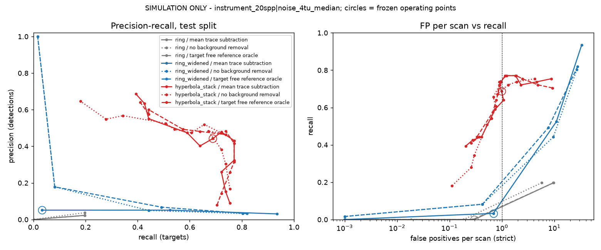
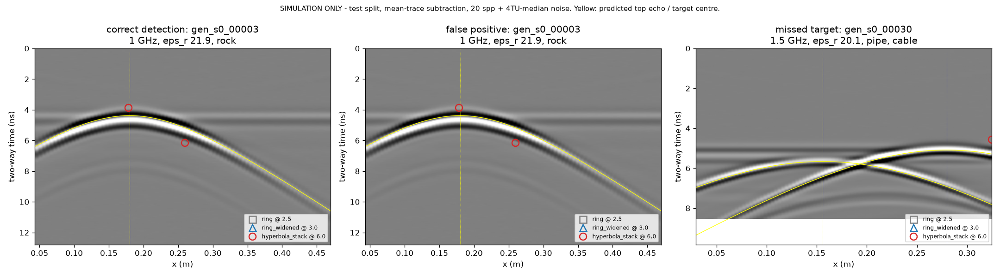

# Detector saturation: three-detector experiment (pre-registration)

**Branch:** `exp/detector-saturation`, from PR #11 (`feat/m1a-pilot-corpus`), which stays unmerged.
**Status:** EXPERIMENTAL. Production behaviour does not change: `anomaly_grid_from_traces`, `TRACE_ANOMALY_WINDOWS`, `find_anomaly_candidates`, the threshold 3.0 and min_cells 3 are untouched.
**Written:** 2026-10-12. Every rule below was committed **before** any experimental detector was run on a corpus scene or a real line. The only exceptions are analytic unit fixtures and a smoke run on one scene, which check that the code executes.

Results go in §9, which is added afterwards. Sections 1–8 must not be edited after results exist. Any deviation is listed in §9 with its reason.

## 1. Question and intended use

The question is whether a wider-window ring or a hyperbola-aware detector can recover the targets the production ring z-score misses, at acceptable false-positive rates and with no unexplained regression on real radar data.

**Intended use.** The detector is a candidate generator. Its candidates are reviewed by an analyst or a later classifier. A missed target cannot be recovered downstream, while a false candidate costs review time. Detection, localisation and classification are separate stages:

- **Detection** decides that a candidate exists.
- **Localisation** reports the candidate's lateral position and time, plus depth if the detector estimates a velocity.
- **Classification** (pipe, void, rock and so on) is **out of scope** here.

**Baselines.**

| | Synthetic | BAM (L-XZ, from PR research/candidate-generation-v2) |
|---|---|---|
| Recall | 0/382 targets in every arm (PR #11) | 0.005 (dev) and 0.053 / 0.000 / 0.271 (L-X) on the held-out scans |
| FP per line | | 2.04 (dev); 2.43 / 5.03 / 2.77 (held out); 2.79 / 1.70 (controls) |

The INGV-UNISA 50-line run produced 2,551 candidates, at the trace-permutation chance rate.

## 2. Detectors (experimental arms)

The production ring and the widened ring produce a z-grid that goes through `benchmark.detection.detect_line` (|z| > threshold, 4-connected components, min_cells 3). The hyperbola stack uses the same rule, so only the statistic differs.

| Arm | What changes | Inputs used at inference |
|---|---|---|
| `ring` | nothing (production) | traces |
| `ring_widened` | the ring's window sizes only | traces |
| `hyperbola_stack` | statistic: one-sided contrast between the envelope stacked along a diffraction hyperbola and along a flat line, maximised over a velocity grid (`benchmark/hyperbola_stack.py`) | traces, trace positions, sample interval, the antenna's nominal centre frequency (instrument metadata), and time zero **estimated from the data** (direct-wave envelope peak of the median raw trace) |

**No inference input comes from simulator truth.** The soil velocity, the wavelet delay, target geometry and the target-free twin are never read by a detector. The oracle background arm uses the twin, and it is labelled as a simulation-only upper bound.

**Velocity grid:** εr 3–25 (9 values). This equals the generator's range, which flatters the hyperbola detector on synthetic data. The limitation is stated, not hidden.

**Non-ideal and overlapping hyperbolas** are handled in three ways:

- a time tolerance (envelope maximum within ±δ along the curve);
- a cone-limited aperture, so overlapping events from other targets fall partly outside;
- per-target one-to-one matching, so a merged response cannot credit two targets.

A point-diffractor, zero-offset curve is assumed. Large-radius targets and shallow targets relative to the antenna offset are mismatched by construction.

## 3. Parameter search spaces (fixed now)

| Arm | Parameters | Grid |
|---|---|---|
| `ring` | threshold only | THRESHOLDS |
| `ring_widened` | trace axis (inner, outer) × depth axis (inner, outer) | {(5,9), (7,13), (11,21)} × {(5,15) production, (9,27)}, giving 6 configurations |
| `hyperbola_stack` | cone half-angle × time tolerance δ | {30°, 45°, 60°} × {0, 1/(4 f_nominal)}, giving 6 configurations |
| all | threshold | THRESHOLDS = 2, 2.5, 3, 3.5, 4, 5, 6, 8, 10, 15, 20, 30 |

## 4. Synthetic corpus, conditions, splits

- **Corpus and splits.** The PR #11 corpus: seed 0, 300 scenes, 382 targets, unchanged. Splits (`SPLIT_VERSION` 2, by random draw) are train 211, val 35 and test 54.
- **Samplings.**
  - `instrument_20spp`: Fourier-resampled to 20 samples per period, the 4TU rate.
  - `native`: the solver's own sampling.
- **Noise.**
  - `noise_free`.
  - `noise_4tu_median`: white Gaussian noise at 2.99×10⁻⁴ of the line's direct-wave reference amplitude, the median over all 759 raw 4TU lines (`simulation/noise_calibration.py`).
  - `noise_4tu_p90`: 1.25×10⁻³, the 90th percentile; used for sensitivity only.
  - Noise is added to the traces, never to the twin, and is seeded from the scene id.
- **Conditions run.** {instrument, native} × {noise_free, noise_4tu_median}, plus instrument × noise_4tu_p90.
- **Background arms.** `no_background_removal`, `mean_trace_subtraction` (production), and `target_free_reference_oracle` (simulation only).
- **Primary condition.** `instrument_20spp` + `noise_4tu_median` + `mean_trace_subtraction`. This is the deployable arm at a realistic sampling and noise level.

## 5. Matching and metrics (from PR #11, `background_benchmark.score_located`)

**Matching rule.**

- A detection is located at its peak |z| cell.
- A detection **matches** a target when two conditions hold:
  - |x − x_centre| ≤ λ_c, the soil wavelength at the centre frequency;
  - t lies within [top-echo apex − T, latest predicted-event apex + T], where T = 1/f.
- Assignment is **one-to-one**. Targets are taken in truth order, and each takes the highest-|z| unmatched detection in its window.
- Unmatched detections are classed, using the first class that applies:
  - **duplicate**: inside a target window;
  - **limb**: within T of a predicted event time on its trace;
  - **early**: before the direct wave has passed;
  - **clutter**: anything else.
- A **missed** target has localisation errors `null`, never zero, and is excluded from error medians.

**Metrics.**

| Metric | Definition |
|---|---|
| Recall | matched targets / targets |
| Precision | matched detections / all detections (duplicates and limbs count against it) |
| FP per scan | all unmatched detections (strict) / scenes |
| FP per empty scene | all detections in empty scenes / empty scenes |
| Lateral error | in λ and m |
| Depth error, own velocity | the detector's own velocity (hyperbola only) |
| Depth error, oracle velocity | diagnostic only, labelled as such |

- **Breakdowns:** soil class, frequency, label and depth bin, plus weak and overlapping echoes:
  - **strength:** weak < 10 dB, moderate 10–25 dB, strong ≥ 25 dB SNR at the 4TU median noise;
  - **overlapping:** another target within λ laterally with an overlapping match window.
- **Cost:** CPU time per scene (process time) and peak memory (`tracemalloc`) per detector, over every scene at the primary condition.
- **Uncertainty:** a scene-level bootstrap with 2,000 resamples and seed 0, giving 95% percentile intervals for recall, precision, FP per scan and FP per empty scene.
- **Curves:** precision–recall and FP–recall over THRESHOLDS for every detector × arm × condition. Sensitivity to noise level, sampling and parameter configuration is shown on **val**.

## 6. Selection and freezing

1. **Selection.** On **train ∪ val** (246 scenes), at the primary condition, every detector configuration × threshold is scored. The selection rule is: maximise recall subject to FP per scan ≤ 1.0. Ties go to the higher threshold, then to the configuration listed first in §3. The production `ring` is also scored at its production threshold of 3.0.
2. **Freezing.** The chosen configuration and threshold for each detector are written to `simulation/detector_freeze.json` and **committed** before the test split is scored. The test split is not read before that commit. The frozen configuration is used unchanged for every arm, condition and sampling.
3. **Test.** The test split (54 scenes) is scored once, with the frozen values.

## 7. Real data

The frozen detector configurations are applied unchanged. Real data has no oracle background, so the arms are mean-trace subtraction and no removal.

- **BAM concrete (L-XZ rule, `benchmark.scoring.score_localization`).** This uses the split of the earlier candidate-V2 experiment:
  - development scan: Pk266 1.5 GHz;
  - held-out scans: Pk266 2.6, Pk401 1.5, and Pk401 2.6 (L-X only);
  - empty controls: Pk050 1.5 and 2.6.

  The synthetic-frozen threshold does not transfer to concrete, so each detector's operating threshold is frozen **on the dev scan only**. It is the threshold with the lowest FP per line at dev L-XZ recall ≥ 0.80. If that recall is unreachable, it is the threshold with the highest dev recall at FP per line ≤ 2.04, the production dev rate.

  The harness is checked first by reproducing the published production numbers.
- **INGV-UNISA, 50 content-unique lines.** I measure each detector's candidate count and multi-trace candidates against a trace-permutation null (10 draws per line), as prescribed after any ring-window change.
- **4TU utility survey.** I compute the activity-level comparison (`benchmark.fourtu_scoring.score_activities`): candidate density per activity against utilities found in the trial trench, on the same 40-file subset as the existing null run.

**Previously reported results** are compared, never re-tuned:

- BAM: production, envelope E1 and Candidate V2;
- INGV: 2,551 candidates and the permutation null;
- 4TU: the activity-level null.

## 8. Decision gate (fixed now)

**S1, meaningful synthetic recovery.** At the primary condition on the **test** split:

- recall ≥ 0.50; and
- the bootstrap 95% lower bound exceeds the upper bound of the production ring's test recall.

**S2, acceptable synthetic false positives.** On the test split at the frozen operating point:

- FP per empty scene ≤ 1.0; and
- precision ≥ 0.50.

**R1, no major real-data regression (BAM).** On every held-out BAM scan at the frozen dev threshold:

- recall ≥ the production detector's published recall on that scan; and
- FP per line on each control ≤ 2× production's (5.58 at 1.5 GHz, 3.40 at 2.6 GHz).

**R2, no unexplained explosion of real-data candidates.** On INGV-UNISA and 4TU:

- candidates per line ≤ 2× the production ring's on the same lines; or
- if above that, the excess is explained by a measured excess over that detector's own permutation null, meaning real lateral structure rather than noise.

**Verdict.**

| Verdict | Condition |
|---|---|
| **PROMOTE FOR FURTHER VALIDATION** | S1, S2, R1 and R2 all pass |
| **KEEP_EXPERIMENTAL** | S1 passes and any of S2, R1 or R2 fails or cannot be measured |
| **REJECT** | S1 fails |

If both arms are rejected, the failure mechanism and the next research approach are reported instead.

**Why these numbers.** The best real-data candidate generator so far is Candidate V2, which reaches 0.62 recall at 2.3 FP per line on held-out Pk266. The synthetic data are 2D and cleaner than any field line, so requiring at least half the targets at one false candidate per empty scene is a bar no weaker than what real data already shows to be possible. The 2× real-data margin allows for a more sensitive detector producing some more candidates. Anything beyond it must be explained.

## 9. Results

Written 2026-10-12, after the frozen test run (freeze commit `9bca277` came before any test scene was scored). Sections 1–8 are unchanged. **SIMULATION ONLY** applies to every synthetic number below. None of them is a field accuracy claim.

**Result files.** Runs write to `artifacts/`, which is git-ignored. The summary outputs are committed under `evidence/detector_saturation/`: `report.json`, `selection.json`, `bam.json`, `ingv.json`, `4tu.json`, `failure_diagnosis.json` and `halfcell_resimulation.json`. The per-scene JSONL files (56 MB) can be regenerated with `python -m simulation.detector_comparison evaluate`.

### 9.1 Verdict

| Arm | S1 | S2 | R1 (BAM) | R2 (INGV / 4TU) | Verdict |
|---|---|---|---|---|---|
| `hyperbola_stack` | **pass**: recall 0.69 [0.58–0.80] vs ring 0.00 [0.00–0.00] | **fail**: precision 0.44 [0.37–0.52] < 0.50 (FP per empty scene 0.00 passes) | **cannot be measured**: no dev threshold meets the §7 rule (see 9.5) | **pass**: INGV 11.4 vs ≤ 102 candidates per line, above its own null on 26/50 lines; 4TU 62.4 vs ≤ 71.5, above its null on 8/40, activity AUC 0.50 vs 0.68 | **KEEP_EXPERIMENTAL** |
| `ring_widened` | **fail**: recall 0.03 [0.00–0.08] | – | – | – | **REJECT** |

The hyperbola stack is the first detector in this project to recover synthetic targets at a realistic noise and sampling level. It does so without simulator truth at inference. It stays experimental for three reasons:

- **Synthetic precision fails, and the limbs are why.** Most of its synthetic false positives are limbs: second responses on the flanks of a hyperbola it has already found.
- **It is not usable on concrete as frozen.** On BAM, no threshold in the pre-registered grid keeps it within the §7 dev budget of 2.04 FP per line. Even at the top of the grid, its Pk050 2.6 GHz control gives 3.9 per line, more than twice production's 1.70.
- **It is slow.** It costs about 20× the ring per synthetic scene and about 300× per BAM line.

The widened ring does not fix saturation. A window wide enough to contain the hyperbola is also wide enough to contain its neighbours, and the extra recall is bought with limb and horizontal-layer responses (9.3).

### 9.2 Synthetic test split, frozen configurations

Frozen configurations (`simulation/detector_freeze.json`): `ring` at threshold 2.5, `ring_widened[t11-21,d9-27]` at 3.0, and `hyperbola_stack[cone45,tol0.25]` at 6.0. Test: 54 scenes, 61 targets, 15 empty scenes. Recall CIs come from the scene bootstrap (2,000 resamples). Errors are medians over matched targets only, and missed targets are excluded, not counted as zero.

**`instrument_20spp|noise_4tu_median`** (primary)

| Detector | Background | Recall [95% CI] | Precision | FP/scan | FP/empty scene | Lateral (λ) | Depth (λ, oracle v) |
|---|---|---|---|---|---|---|---|
| ring | mean-trace | 0.00 [0.00–0.00] | 0.00 | 0.30 | 0.53 | – | – |
| ring | none | 0.00 [0.00–0.00] | 0.00 | 0.19 | 0.33 | – | – |
| ring | oracle (sim only) | 0.00 [0.00–0.00] | 0.00 | 0.28 | 0.40 | – | – |
| ring_widened | mean-trace | 0.03 [0.00–0.08] | 0.05 | 0.69 | 0.00 | 0.55 | 0.52 |
| ring_widened | none | 0.08 [0.02–0.15] | 0.18 | 0.43 | 0.00 | 0.33 | 0.05 |
| ring_widened | oracle (sim only) | 0.08 [0.02–0.15] | 0.18 | 0.43 | 0.00 | 0.33 | 0.05 |
| hyperbola_stack | mean-trace | 0.69 [0.58–0.80] | 0.44 | 0.98 | 0.00 | 0.03 | 0.28 |
| hyperbola_stack | none | 0.61 [0.51–0.71] | 0.47 | 0.76 | 0.00 | 0.03 | 0.25 |
| hyperbola_stack | oracle (sim only) | 0.74 [0.63–0.85] | 0.46 | 0.96 | 0.00 | 0.03 | 0.26 |

**`instrument_20spp|noise_free`**

| Detector | Background | Recall [95% CI] | Precision | FP/scan | FP/empty scene | Lateral (λ) | Depth (λ, oracle v) |
|---|---|---|---|---|---|---|---|
| ring | mean-trace | 0.00 [0.00–0.00] | 0.00 | 0.43 | 1.53 | – | – |
| ring | none | 0.00 [0.00–0.00] | 0.00 | 0.13 | 0.40 | – | – |
| ring | oracle (sim only) | 0.00 [0.00–0.00] | 0.00 | 0.02 | 0.00 | – | – |
| ring_widened | mean-trace | 0.03 [0.00–0.08] | 0.03 | 1.19 | 0.93 | 0.55 | 0.52 |
| ring_widened | none | 0.08 [0.02–0.15] | 0.25 | 0.28 | 0.00 | 0.33 | 0.05 |
| ring_widened | oracle (sim only) | 0.08 [0.02–0.15] | 0.17 | 0.44 | 0.00 | 0.33 | 0.05 |
| hyperbola_stack | mean-trace | 0.69 [0.58–0.80] | 0.24 | 2.41 | 5.07 | 0.03 | 0.27 |
| hyperbola_stack | none | 0.61 [0.51–0.71] | 0.53 | 0.61 | 0.00 | 0.03 | 0.25 |
| hyperbola_stack | oracle (sim only) | 0.74 [0.63–0.85] | 0.47 | 0.94 | 0.00 | 0.03 | 0.26 |

**`instrument_20spp|noise_4tu_p90`**

| Detector | Background | Recall [95% CI] | Precision | FP/scan | FP/empty scene | Lateral (λ) | Depth (λ, oracle v) |
|---|---|---|---|---|---|---|---|
| ring | mean-trace | 0.00 [0.00–0.00] | 0.00 | 0.24 | 0.27 | – | – |
| ring | none | 0.00 [0.00–0.00] | 0.00 | 0.20 | 0.33 | – | – |
| ring | oracle (sim only) | 0.00 [0.00–0.00] | 0.00 | 0.30 | 0.47 | – | – |
| ring_widened | mean-trace | 0.03 [0.00–0.08] | 0.06 | 0.57 | 0.00 | 0.55 | 0.53 |
| ring_widened | none | 0.07 [0.02–0.12] | 0.22 | 0.26 | 0.00 | 0.32 | 0.06 |
| ring_widened | oracle (sim only) | 0.07 [0.02–0.12] | 0.22 | 0.26 | 0.00 | 0.32 | 0.06 |
| hyperbola_stack | mean-trace | 0.72 [0.61–0.83] | 0.42 | 1.15 | 0.00 | 0.03 | 0.27 |
| hyperbola_stack | none | 0.62 [0.53–0.73] | 0.54 | 0.61 | 0.00 | 0.03 | 0.25 |
| hyperbola_stack | oracle (sim only) | 0.70 [0.60–0.81] | 0.42 | 1.09 | 0.00 | 0.03 | 0.26 |

**`native|noise_4tu_median`**

| Detector | Background | Recall [95% CI] | Precision | FP/scan | FP/empty scene | Lateral (λ) | Depth (λ, oracle v) |
|---|---|---|---|---|---|---|---|
| ring | mean-trace | 0.05 [0.00–0.11] | 0.01 | 4.54 | 5.80 | 0.42 | 0.57 |
| ring | none | 0.03 [0.00–0.08] | 0.01 | 3.83 | 4.33 | 0.22 | 0.48 |
| ring | oracle (sim only) | 0.03 [0.00–0.08] | 0.01 | 4.48 | 4.93 | 0.22 | 0.48 |
| ring_widened | mean-trace | 0.11 [0.05–0.19] | 0.02 | 7.80 | 0.00 | 0.73 | 0.52 |
| ring_widened | none | 0.15 [0.07–0.22] | 0.02 | 7.69 | 0.00 | 0.73 | 0.46 |
| ring_widened | oracle (sim only) | 0.15 [0.07–0.22] | 0.02 | 7.67 | 0.00 | 0.73 | 0.46 |
| hyperbola_stack | mean-trace | 0.61 [0.48–0.74] | 0.10 | 6.43 | 0.00 | 0.03 | 0.24 |
| hyperbola_stack | none | 0.52 [0.39–0.67] | 0.09 | 6.19 | 0.00 | 0.03 | 0.22 |
| hyperbola_stack | oracle (sim only) | 0.61 [0.49–0.73] | 0.10 | 6.46 | 0.07 | 0.03 | 0.22 |

**`native|noise_free`**

| Detector | Background | Recall [95% CI] | Precision | FP/scan | FP/empty scene | Lateral (λ) | Depth (λ, oracle v) |
|---|---|---|---|---|---|---|---|
| ring | mean-trace | 0.00 [0.00–0.00] | 0.00 | 135.30 | 276.27 | – | – |
| ring | none | 0.00 [0.00–0.00] | 0.00 | 126.26 | 261.07 | – | – |
| ring | oracle (sim only) | 0.02 [0.00–0.05] | 0.00 | 30.22 | 0.00 | 0.99 | 0.51 |
| ring_widened | mean-trace | 0.20 [0.11–0.29] | 0.01 | 43.41 | 26.53 | 0.53 | 0.42 |
| ring_widened | none | 0.20 [0.11–0.29] | 0.01 | 38.54 | 13.20 | 0.58 | 0.42 |
| ring_widened | oracle (sim only) | 0.20 [0.11–0.29] | 0.01 | 36.24 | 0.00 | 0.58 | 0.42 |
| hyperbola_stack | mean-trace | 0.54 [0.41–0.69] | 0.06 | 9.52 | 17.13 | 0.03 | 0.26 |
| hyperbola_stack | none | 0.46 [0.32–0.61] | 0.11 | 4.33 | 0.00 | 0.03 | 0.24 |
| hyperbola_stack | oracle (sim only) | 0.54 [0.41–0.69] | 0.11 | 5.02 | 0.00 | 0.03 | 0.25 |

**What the tables show**

- **The production ring finds nothing at the primary condition.** It recovers 0 of 61 test targets in every background arm, at both instrument-rate noise levels and at native/noise-free. The native/4TU-median cell, at 0.05, is the exception: three hits at 4.5 FP per scan, which is chance-level. This confirms the saturation result of PR #11 on held-out scenes.
- **The hyperbola stack's recall barely moves with noise.** At instrument rate it is 0.69 noise-free, 0.69 at the 4TU median and 0.72 at the 4TU p90.
  - Lateral error is 0.03 λ (median 2.9 mm), the best of any arm.
  - Depth error with the oracle velocity is 0.28 λ. The signed median is −0.27 λ: the peak sits slightly above the predicted apex, which is consistent with the envelope peak preceding the zero-crossing pick.
  - Using its own velocity estimate, depth error is 0.39 λ and the median velocity error is 11%.
- **The frozen threshold does not transfer across sampling.** At native sampling the same z = 6 gives 6.4 FP per scan (precision 0.10). The robust z depends on how many correlated samples a cell has, so a threshold has to be frozen per sampling rate. Real instruments sample near the instrument rate, which is why that rate is primary.
- **Noise-free, mean-trace subtraction is degenerate for robust z-statistics.** The hyperbola stack gives 5.1 FP per empty scene and the production ring 276 at native sampling. A residual of nearly zero has a MAD of nearly zero, so any numerical residue becomes a large z. Adding realistic noise removes it (0.00 FP per empty scene). This is a property of the synthetic data, not of the detector, and the primary condition is not affected.
- **Background arm.** For the hyperbola stack:
  - The oracle arm is a simulation-only upper bound, and it beats mean-trace subtraction only slightly (0.74 against 0.69).
  - No removal gives less recall (0.61) at higher precision (0.47).
  - Mean-trace subtraction is therefore not what limits it.

**Where the unmatched detections come from (test split, frozen thresholds, mean-trace)**

| Condition | Detector | Detections | Matched | Limb | Duplicate | Early | Clutter |
|---|---|---|---|---|---|---|---|
| instrument / 4TU median (primary) | ring | 16 | 0 | 0 | 0 | 6 | 10 |
| | ring_widened | 39 | 2 | 20 | 0 | 5 | 12 |
| | hyperbola_stack | 95 | 42 | **31** | 1 | 2 | 19 |
| native / 4TU median | ring | 248 | 3 | 33 | 0 | 78 | 134 |
| | ring_widened | 428 | 7 | **384** | 35 | 0 | 2 |
| | hyperbola_stack | 384 | 37 | 113 | 28 | 29 | 177 |

At the primary condition, 31 of the hyperbola stack's 53 unmatched detections are limbs: a second component on the flank of an already-detected hyperbola, at a velocity that also fits there. With those 31 removed, precision would be 42/64 = 0.66. That figure is **not** a result. It would need a post-detection grouping or non-maximum-suppression stage that was not pre-registered, and it is the obvious next step. It belongs to localisation, kept separate from detection as §1 requires.

**Breakdowns: hyperbola stack, primary condition, matched/targets**

| | | | | | |
|---|---|---|---|---|---|
| Frequency | 0.25 GHz 6/7 | 0.5 GHz 10/14 | 1 GHz 11/17 | 1.5 GHz 4/8 | 2.6 GHz 11/15 |
| Soil | dry 6/8 | moist 12/16 | wet 24/37 | | |
| Label | cable 10/14 | pipe 11/14 | rock 7/15 | void 14/18 | |
| Depth | shallow 10/14 | mid 17/18 | deep 15/29 | | |
| Overlapping | no 41/57 | **yes 1/4** | | | |
| Strength | strong 42/61 | (weak 0, moderate 0) | | | |

- **Rock is the weakest class** (7/15). Rock's top reflection coefficient is the smallest in the corpus, the same property that drives the validation failures in 9.6.
- **Deep targets are recovered about half as often** as mid-depth ones.
- **Overlapping echoes:** 1 of 4. The sample is too small to call, but it is consistent with the merged response crediting only one target under one-to-one matching.
- **Weak echoes cannot be measured on this corpus.** Every test target is "strong" (≥ 25 dB SNR) at both the 4TU median and p90 noise. The pre-registered strength bins are empty below 25 dB, so the weak-echo question needs a noisier or deeper corpus.

The production ring's breakdowns are all 0/n and are not repeated. The widened ring's 2/61 matches are both 0.5 or 2.6 GHz in moist soil, and both deep.

**Cost (primary condition, per scene, process CPU time; `tracemalloc` peak)**

| Detector | Median CPU | Max CPU | Peak memory |
|---|---|---|---|
| ring | 0.08 s | 0.12 s | 2.8 MB |
| ring_widened | 0.08 s | 0.10 s | 2.8 MB |
| hyperbola_stack | 1.54 s | 2.04 s | 2.8 MB |
| hyperbola_stack, native sampling | 8.6 s | 11.3 s | 28.9 MB |

The peak memory is dominated by the conditioned line itself, so it does not separate the detectors. On real lines the hyperbola stack's cost grows with the cone aperture in traces. BAM, with 401 traces at 1.5 mm, costs 29 s per line against 0.1 s for the ring.

### 9.3 Sensitivity (train ∪ val selection table; val shown separately)

Best recall at FP per scan ≤ 1.0 for each configuration, primary condition (`artifacts/simulation/detector_experiment/selection.json`):

| Configuration | Threshold | Train+val recall | FP/scan | Precision | Val recall | Val FP/scan |
|---|---|---|---|---|---|---|
| ring | 2.5 | 0.016 | 0.22 | 0.09 | 0.000 | 0.31 |
| ring_widened t5-9, d5-15 | 3.0 | 0.012 | 0.08 | 0.17 | 0.000 | 0.00 |
| ring_widened t5-9, d9-27 | 3.0 | 0.087 | 0.30 | 0.28 | 0.047 | 0.31 |
| ring_widened t7-13, d5-15 | 3.0 | 0.016 | 0.08 | 0.21 | 0.023 | 0.06 |
| ring_widened t7-13, d9-27 | 3.0 | 0.084 | 0.26 | 0.29 | 0.070 | 0.29 |
| ring_widened t11-21, d5-15 | 3.0 | 0.034 | 0.63 | 0.07 | 0.023 | 0.51 |
| **ring_widened t11-21, d9-27** | 3.0 | **0.112** | 0.78 | 0.16 | 0.070 | 1.03 |
| hyperbola cone 30°, δ 0 | 30 | 0.408 | 0.64 | 0.45 | 0.488 | 0.54 |
| hyperbola cone 30°, δ T/4 | 15 | 0.464 | 0.77 | 0.44 | 0.488 | 0.54 |
| hyperbola cone 45°, δ 0 | 15 | 0.542 | 0.93 | 0.43 | 0.535 | 0.89 |
| **hyperbola cone 45°, δ T/4** | 6 | **0.701** | 0.98 | 0.48 | 0.651 | 0.83 |
| hyperbola cone 60°, δ 0 | 6 | 0.632 | 0.85 | 0.49 | 0.628 | 0.77 |
| hyperbola cone 60°, δ T/4 | 4 | 0.626 | 0.86 | 0.49 | 0.674 | 0.77 |

- **The hyperbola stack is moderately sensitive to its two parameters.** The three best configurations (45° with δ T/4, and 60° with either δ) lie within 0.08 of each other on train+val (0.63–0.70) and within 0.05 on val. A narrow 30° cone, or dropping the tolerance at 45°, costs 0.16–0.29.
- **Widening the ring's trace window helps only when the depth window widens too.** The best widened ring recovers 1 target in 9. The ring's statistic compares a cell with its own neighbourhood, and once the window covers the hyperbola's lateral extent it covers its flanks as well. That is why its unmatched detections on test are mostly limbs (20/37 at the primary condition, 384/421 at native sampling).
- **Noise and sampling** sensitivity is in the tables of 9.2 and in `docs/figures/detector_saturation_conditions_val.png`.

### 9.4 Figures

- `docs/figures/detector_saturation_pr_test.png` and `..._pr_val.png`: precision–recall and FP-per-scan–recall for every detector × background arm at the primary condition, with the frozen points circled.
- `docs/figures/detector_saturation_conditions_test.png` and `..._conditions_val.png`: recall against FP per scan for each condition (mean-trace arm).
- `docs/figures/detector_saturation_examples.png`: test B-scans chosen by the fixed rule in `simulation/detector_plots.py`.
  - The first test scene in sorted order with a correct detection is `gen_s0_00003`, a rock at 1 GHz.
  - The rule also picked `gen_s0_00003` as the first false-positive scene. Its false positive is a **limb** at x = 0.26 m on the same hyperbola, which is the dominant failure mode, so the rule was kept and the panel duplicated rather than re-chosen.
  - The first missed-target scene is `gen_s0_00030`: a pipe and a cable at 1.5 GHz whose hyperbolas cross. The cable's apex is near the line end, and neither target is credited.

### 9.5 Real-data regression report

#### BAM concrete (`artifacts/bam/detector_saturation.json`)

**Harness check.** The production ring, run through this harness on all 161 lines at 3.0, reproduces every published number. Recall / FP per line:

| Scan | Reproduced | Published |
|---|---|---|
| dev Pk266 1.5 | 0.005 / 2.04 | 0.005 / 2.04 |
| Pk266 2.6 | 0.053 / 2.43 | 0.053 / 2.43 |
| Pk401 1.5 | 0.000 / 5.03 | 0.000 / 5.03 |
| Pk401 2.6 (L-X) | 0.271 / 2.77 | 0.271 / 2.77 |
| Pk050 1.5 | – / 2.79 | – / 2.79 |
| Pk050 2.6 (L-X) | – / 1.70 | – / 1.70 |

**Dev-frozen thresholds (§7 rule, 41 lines).**

- `ring` and `ring_widened` are frozen at 30.0. Neither reaches dev recall 0.80, and every threshold that meets FP per line ≤ 2.04 has dev recall 0. The tie-break then picks the highest threshold.
  - The production ring at 3.0 gives 2.3 FP per line on these 41 lines, so it narrowly fails the budget.
  - The frozen ring and widened ring therefore detect nothing on any scan. That is a regression **by construction of the rule**, not a measured property.
- `hyperbola_stack` gets **no threshold**. It never reaches recall 0.80 on dev at FP per line ≤ 2.04: its lowest dev FP per line is 2.7, at threshold 30, with recall 0.43. By the §7 rule R1 cannot be measured, and the verdict treats it as "cannot be measured".

**Descriptive only, not used by the gate.** These are full curves on the 41 lines, mean-trace arm. A point is recall / FP per line (L-XZ; L-X on Pk401 2.6). The hyperbola column uses the grid's top threshold, 30, the lowest-FP point on dev.

| Scan | Production @3.0 (published, 161 lines) | Candidate V2 (published) | Hyperbola stack @30 | Hyperbola stack @6 (synthetic-frozen) | Widened ring @3.0 (synthetic-frozen) |
|---|---|---|---|---|---|
| dev Pk266 1.5 | 0.005 / 2.04 | 0.811 / 0.50 | 0.43 / 2.7 | 0.62 / 6.8 | 0.12 / 105 |
| Pk266 2.6 | 0.053 / 2.43 | 0.623 / 2.32 | 0.63 / 1.9 | 0.49 / 8.6 | 0.10 / 73 |
| Pk401 1.5 | 0.000 / 5.03 | 0.063 / 0.96 | 0.63 / 6.2 | 0.50 / 26.4 | 0.13 / 64 |
| Pk401 2.6 (L-X) | 0.271 / 2.77 | 0.219 / 0.07 | 0.67 / 7.9 | 1.00 / 58.9 | 1.00 / 38 |
| Pk050 1.5 (control) | – / 2.79 | – / 3.02 | – / 3.1 | – / 7.7 | – / 68 |
| Pk050 2.6 (control, L-X) | – / 1.70 | – / 2.83 | – / 3.9 | – / 8.0 | – / 42 |

**What this shows.**

- **On the duct-bearing held-out scan Pk266 2.6**, the hyperbola stack at the grid's top threshold matches Candidate V2: 0.63 recall at 1.9 FP per line, against 0.62 at 2.3. This is with no concrete-specific design.
- **On Pk401 1.5**, where every earlier detector fails, it recovers 0.63, but at 6 FP per line.
- **It still fails R1 even at its most favourable point.** Its Pk050 2.6 control rate of 3.9 per line exceeds the 3.40 allowed.
- **The synthetic-frozen z = 6 does not transfer to concrete.** It gives 6–59 FP per line, a large regression against production.
- **The widened ring at its synthetic threshold is a severe regression everywhere**, at 38–105 FP per line. Its windows pick up the concrete's layered back-wall and reinforcement responses, which is the horizontal-reflector sensitivity the brief warned about.
- **No removal does better than mean-trace subtraction on BAM.** For the hyperbola stack, Pk266 2.6 gives 0.87 / 7.1 at threshold 6 against 0.49 / 8.6, and the controls are lower at every threshold. This was not pre-registered and was not used for any choice. It is recorded for the next phase.
- **Cost.** The hyperbola stack takes a median of 29 s per BAM line against 0.1 s for the ring.

#### INGV-UNISA, 50 content-unique lines (`artifacts/realdata/ingv.json`)

**Setup.** The frequency is the spectral peak: median 71 MHz, range 63–106 MHz. Trace spacing is the median 0.26 m from the header source X/Y. The arm is mean-trace subtraction, and the null is 10 trace-order permutations of each raw line.

**Harness check.** The production ring at 3.0 gives **2,551 candidates**, the same count as the 2026-08-06 baseline.

| Detector (threshold) | Candidates | Per line | ≥ 3-trace candidates | Null mean (total) | Null ≥ 3-trace | Lines above null p95 | Lines above null mean | Median CPU per line |
|---|---|---|---|---|---|---|---|---|
| ring @3.0 (production) | 2,551 | 51.0 | 0 | 9,323 | 0 | 0 | 2 | 0.04 s |
| ring @2.5 (synthetic-frozen) | 9,362 | 187.2 | 0 | 22,109 | 0 | 0 | 0 | 0.04 s |
| ring_widened @3.0 | 5,619 | 112.4 | 372 | 12,055 | 28.6 | 1 | 1 | 0.04 s |
| hyperbola_stack @6.0 | **569** | **11.4** | 201 | 578 | 179.5 | **22** | **26** | 0.91 s |

**R2 (INGV).**

- **hyperbola_stack: pass.** It gives 11.4 candidates per line, against a ceiling of 102.0, twice production's rate.
  - Unlike every ring variant, it exceeds its own permutation null on about half the lines: 26 of 50 above the null mean and 22 of 50 above the null p95.
  - Its per-line median is 3 real candidates against 0.6 under the null.
  - Its overall total sits at the null level only because a few long lines have higher null counts. Line C1T_7,5 is the largest case: 118 real against 244 null.
- **ring_widened: fails R2.** It gives 112.4 per line, above the 102.0 ceiling, and the excess is not explained by its null, which is higher on 49 of 50 lines.

**Two points about this null.**

1. **Permuting traces raises every ring variant's count** by 2–4× here. The ring compares a cell with its lateral neighbours, so shuffling the traces creates lateral contrast. The 2026-08-06 "chance rate" statement used a different null, and the two are not comparable.
2. **The per-line permutation p-value can't go below 1/11 = 0.09 with 10 draws.** The "p < 0.05" column is therefore uninformative by construction. The p95 and mean comparisons above are what count.

#### 4TU utility survey, 40-file subset (`artifacts/realdata/4tu.json`)

**Setup.** 500 MHz nominal, 0.02 m trace spacing from group X, mean-trace arm, and 10 trace permutations per line. The lines run to 7,130 traces.

| Detector (threshold) | Candidates | Per line | ≥ 3-trace | Null mean (total) | Lines above null mean | Lines above null p95 | Activity AUC (26 utility vs 4 trench-empty) | Median CPU per line |
|---|---|---|---|---|---|---|---|---|
| ring @3.0 (production) | 1,429 | 35.7 | 0 | 43,812 | 0 | 0 | 0.68 | 0.11 s |
| ring @2.5 (synthetic-frozen) | 7,565 | 189.1 | 63 | 90,919 | 0 | 0 | 0.63 | 0.09 s |
| ring_widened @3.0 | 8,026 | 200.7 | 3,797 | 27,959 | 3 | 1 | 0.68 | 0.09 s |
| hyperbola_stack @6.0 | 2,495 | **62.4** | 2,095 | 4,704 | **8** | 4 | **0.50** | 13 s (max 1,029 s) |

**R2 (4TU).**

- **hyperbola_stack: pass.** It gives 62.4 candidates per line, against a ceiling of 71.5, twice production's rate. Combined with INGV, **R2 passes**.
- Its excess over the null is weaker here than on INGV: 8 of 40 lines are above the null mean and 4 above the p95. Most of its candidates span 3 or more traces, but so do most null candidates (1,962), so that width is not evidence of real lateral structure on this corpus.
- **ring_widened fails R2.** It gives 200.7 per line, more than 5× production, and the excess is not explained by its null.

**Activity level.** This is `score_activities`: candidates per 1,000 traces in activities where the trial trench found utilities, against trench-empty activities.

- The hyperbola stack shows **no separation (AUC 0.50)**. The production ring shows 0.68.
- With only 4 trench-empty activities, AUC moves in steps of 1/104 and has a wide interval, so this is a weak, unpowered signal. It is recorded as a possible regression, not established.
- Every arm's count agreement with the number of utilities found is near zero (|ρ| ≤ 0.15).

**Cost.** The hyperbola stack's cost grows with line length × aperture. The 7,130-trace line took 1,029 s for one pass (11 passes with the null), which makes a 4,000-trace-plus 4TU line impractical without a faster implementation.

### 9.6 The 12 validation failures and scene 13 (separate from the detector work)

This analysis is in `simulation/failure_investigation.py`, with output in `artifacts/simulation/investigation/diagnose.json`. **No tolerance, rule, simulator setting or truth model was changed.** It is diagnostic only.

**All 12 failing scenes fail only the apex-trace check.** No scene fails the time or shape check.

**How failing scenes differ from the 131 passing ones** (Mann–Whitney, medians failing vs passing):

| Feature | Failing | Passing | p |
|---|---|---|---|
| Apex distance from the line end (traces) | 15 | 26 | 2e-5 |
| Top-to-internal echo separation (periods) | 1.44 | 0.46 | 0.0008 |
| Half-offset / depth | 0.07 | 0.13 | 0.001 |
| Depth of the top / λ | 3.4 | 2.0 | 0.001 |
| Direct-wave clearance (periods) | 5.3 | 2.6 | 0.001 |
| Grid cells per λ inside the target | 29 | 94 | 0.001 |
| Target εr | 8.4 | 1.0 | 0.005 |
| \|R\| at the top | 0.18 | 0.66 | 0.013 |
| Soil εr | 6.7 | 14.5 | 0.053 |
| Frequency, radius / λ, cells per λ in soil | – | – | > 0.29 |

**Weighing the brief's four candidate mechanisms against this.**

- **Weak contrast: yes, as a contributor.**
  - The failing targets are mostly rocks with a small |R|.
  - Their internal echo is separated from the top echo, so the picker can switch between the two.
- **Overlapping echoes: yes, within a target.** The top and internal echoes of the same target are the overlap, not echoes from neighbouring targets.
- **Antenna effects: no.** Half-offset / depth is *smaller* in the failing scenes, so the zero-offset approximation is better there, not worse.
- **Model limits (discretisation): no.**
  - Cells per λ in the soil, where the scored path lies, is the same for failing and passing scenes.
  - The difference inside the target (29 vs 94) reflects target εr, and 29 is still about 3× the usual 10 cells per λ rule.
  - The analytic forward model below fails these scenes with no discretisation at all.

**The analytic forward model reproduces all 12 failures.** It predicts exact arrival times and Fresnel signs, puts a windowed envelope amplitude on each event, and uses the simulation's own residual as the floor, all with the v3 analysis unchanged.

- It gets the same sign and a similar vertex error on every one of the 12, with apex-time error ≤ 6 ps on 10 of 12 scenes.
- Its per-trace pick agreement with the simulation is 0.95–1.00.
- Fitting the vertex to picks on the scored event only, as a diagnostic and not a rule, brings 11 of 12 within tolerance. The exception is scene 22, at −3 traces.

**The mechanism:**

1. The v3 analysis fits one t² parabola over all 80 picks.
2. On deep, low-contrast, near-edge targets, a few picks fall on the other event of the same target, or switch events part-way along the line.
3. Because the apex sits near the line end, the parabola has only one well-sampled flank, so those picks drag the vertex sideways.

That is a limitation of the **analysis**, not of the solver or the truth. It is not an independent physical reason to loosen the apex tolerance, so the tolerance stays. The remedy, for a later and separately pre-registered analysis version, is per-event vertex fitting with a pick-to-event assignment.

**Scene 13 (+110 ps apex-time residual).** The analytic forward model passes scene 13 with an apex error of −1 ps. Under the same analysis and geometry, an ideal wavefield gives no residual, so the 110 ps is **not** a picking or interference artefact. It is in the simulated wavefield.

- **Losses are negligible:** σ/(ωε) ≈ 0.001 in the rock and 0.009 in the soil.
- **The predicted geometry matches** the closed-form zero-offset time.
- **The remaining candidate is discretisation:** staircasing of the rock boundary and numerical dispersion inside the rock.

**Half-cell re-simulation** (`artifacts/simulation/investigation/resimulate.json`). The same scenarios were run with the grid cell halved and everything else unchanged.

| Scene | Cell | Pass | Vertex error (traces) | Apex-time residual | Shape RMS |
|---|---|---|---|---|---|
| 13 | 2.4 → 1.2 mm | pass → pass | 0 → 0 | **112 → 78 ps** | 110 → 78 ps |
| 135 | 3.3 → 1.65 mm | fail → fail | −18 → −18 | 179 → 120 ps | 174 → 119 ps |
| 277 | 4.0 → 2.0 mm | fail → fail | 8 → 7 | 233 → 163 ps | 231 → 160 ps |

**Reading.**

- **The time residual is partly discretisation.** Halving the cell removes about 30% of it in all three scenes. The ratio is 0.69–0.70 each time, which is systematic and not noise.
- **Discretisation does not explain all of it.** The residual falls more slowly than the solver's second-order dispersion would predict: dispersion error should scale by about 0.25 per halving, and first-order staircasing by 0.5. An apparent order of about 0.5 suggests an additional component that does not converge with the cell size, or converges slowly.
  - Candidates are the definition of the source wavelet delay or time zero in the truth model, and the reflection phase at a dispersive or lossy boundary.
  - Neither is tested here. Separating them would need a third refinement, Δ/4.
- **The vertex failures of scenes 135 and 277 do not move with the cell** (−18 → −18 and 8 → 7). This independently confirms that the apex-trace failures are not a discretisation effect, consistent with the analytic forward model above.
- **Scene 13 still passes.** Its residual is within the time tolerance at both resolutions, so no rule or tolerance is affected.

### 9.7 Deviations from §1–8

1. **BAM was scored on 41 evenly spaced lines per scan**, the same lines for every detector, not all 161. The cost reason is in 9.2. The production ring was also run on all 161 lines as the harness check.
2. **The BAM matcher is the Candidate-V2 harness scorer**, ported verbatim (`scripts/bam_detector_saturation.score`), not `benchmark.scoring.score_localization` as §7 names. It applies the same L-XZ rule and reproduces the published production numbers exactly.
3. **INGV antenna frequency.** It is not in the SEG-Y headers, so it is taken from the spectral peak of each line's own mean amplitude spectrum. That frequency is used only for the hyperbola stack's tolerance δ.
4. **INGV and 4TU thresholds.** These use the synthetic-frozen thresholds, plus the production ring at 3.0. §7 did not say which threshold to use on corpora without object truth, and nothing was tuned on them.
5. **The 4TU file subset** follows `characterise_4tu_null.py`'s own rule: seed 20260807, 40 files. The stored `artifacts/4tu/null.json` was produced on 12 files with 8 draws, so its absolute counts are not directly comparable.
6. **The weak-echo breakdown is empty.** No test target falls below 25 dB SNR at the pre-registered noise levels (9.2).
7. **The examples figure repeats a scene.** Its fixed rule selected `gen_s0_00003` for both the correct-detection and the false-positive panel (9.4).

### 9.8 Unresolved

- **Limb suppression.** Grouping hyperbola-stack components that share one apex-velocity solution is the obvious next step for precision. It needs its own pre-registration and a fresh test split, or the current split declared spent.
- **Per-sampling thresholds.** The robust z has to be calibrated per sampling rate and per corpus, or replaced with a statistic whose null distribution does not depend on sample density.
- **BAM background.** No removal outperforms mean-trace subtraction on concrete. This is untested as a hypothesis.
- **Cost.** About 30 s per 401-trace line. A coarse-to-fine velocity search or an FFT-based migration would be needed before any interactive use.
- **The weak-echo regime** is not covered by the 300-scene corpus.
- **Scene 13's residual:** about 30% of it is cell-size dependent. The rest is not explained, and it needs a Δ/4 run plus a check of the truth model's time-zero convention.
